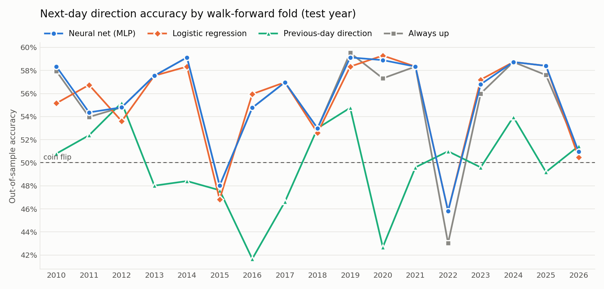
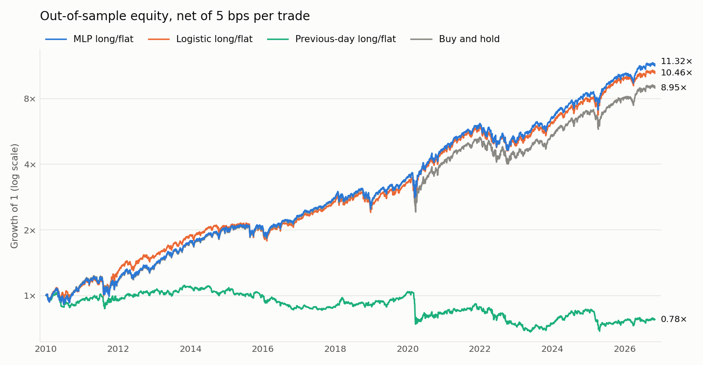

# S&P 500 next-day direction with a neural network — an honest evaluation

Predicts whether SPY closes up or down tomorrow with a small PyTorch MLP, and
checks it against simple baselines using walk-forward testing.

**Bottom line: the model has no demonstrable skill.** Over 4,232 out-of-sample
days (2010–2026) it was right 55.58% of the time; always guessing "up" was
right 55.20%. The difference is not statistically significant, the AUC is 0.499
(a coin flip), and the model says "up" on 97.7% of days. It learned the base
rate, not the direction. The long/flat back-test does finish ahead of
buy-and-hold, but that result rests on a handful of days and does not survive
scrutiny (details below).

## Setup

| | |
|---|---|
| Target | Sign of the next daily close-to-close return of SPY (dividend-adjusted). A flat day counts as "down". |
| Data | Yahoo Finance via `yfinance`: SPY and ^VIX daily bars, 2000-01-03 to 2026-10-30. Cached in `data/`. |
| Features (23) | Daily returns lagged 0–4 days; momentum over 5/10/21/63 days; realised volatility over 5/21/63 days; RSI(14); price vs 10/50/200-day moving average; 50- vs 200-day average; log VIX, its 1- and 5-day change, VIX vs its 21-day average; volume vs its 21-day average; daily high–low range. |
| Model | Feed-forward MLP, 23 → 32 → 16 → 1, ReLU, dropout 0.2, AdamW (lr 1e-3, weight decay 1e-3), batch 256, early stopping (patience 20) on the most recent 15% of the training fold. Probabilities averaged over 5 seeds. |
| Baselines | Always up; logistic regression on the same features; previous-day direction. |
| Splits | Expanding window, 17 folds. Fold *Y* trains on everything before year *Y* and tests on year *Y* (2010 … 2026; 2026 runs to Oct 29). |
| Decision rule | Predict up / be long when P(up) > 0.5. |
| Back-test | Long SPY or flat (cash at 0%), decided at the close, 5 bps per trade. |

The request left these choices open, so they are defaults I picked. All of them
live in [spdir/config.py](spdir/config.py). They were fixed before the first
out-of-sample run and nothing was changed after seeing test results; later
re-runs only added reporting, and reproduced the predictions byte for byte.

## Run it

```bash
python3 -m venv .venv && .venv/bin/pip install -r requirements.txt
```

```bash
.venv/bin/python run.py
```

```bash
.venv/bin/python -m pytest -q
```

`run.py` goes data → features → walk-forward training → evaluation in about 30
seconds on a laptop CPU and writes everything to `outputs/`. It reads the
cached CSVs in `data/`; pass `--refresh` to re-download (Yahoo revises adjusted
prices, so a fresh download can change results slightly). Seeds are fixed and
PyTorch runs single-threaded in deterministic mode: two consecutive runs on the
same machine give identical `predictions.csv`. Other hardware or library
versions may differ in the last decimal places.

## Results

Full tables, including every per-fold confusion matrix, are in
[outputs/results.md](outputs/results.md) (generated by the pipeline).

### Classification, pooled over all out-of-sample days (n = 4,232; 55.20% were up days)

| Model | Accuracy | Balanced accuracy | AUC | Share of days predicted up |
|---|---|---|---|---|
| Neural net (MLP) | 55.58% | 50.62% | 0.499 | 97.7% |
| Logistic regression | 55.36% | 50.66% | 0.496 | 95.3% |
| Previous-day direction | 49.74% | 49.19% | 0.492 | 55.2% |
| Always up | 55.20% | 50.00% | 0.500 | 100% |

Pooled confusion matrices (rows = actual, columns = predicted):

| | MLP: pred. down | MLP: pred. up | Logistic: pred. down | Logistic: pred. up |
|---|---|---|---|---|
| Actual down | 56 | 1,840 | 103 | 1,793 |
| Actual up | 40 | 2,296 | 96 | 2,240 |



The MLP's line sits on top of always-up because in 9 of 17 folds it predicted
"up" every single day. By fold, its accuracy beat always-up in 6, tied in 10
and lost in 1; logistic regression won 6, tied 4 and lost 7. Per-fold AUC for
the MLP ranges from 0.42 to 0.55 with no pattern.

### Does accuracy beat 50%, and does it beat always-up?

One-sided tests, pooled over all out-of-sample days.

| Model | Accuracy (95% CI) | p vs 50% | p vs always-up (binomial) | p vs always-up (exact McNemar) |
|---|---|---|---|---|
| Neural net (MLP) | 55.58% (54.06–57.08%) | 2e-13 | 0.32 | 0.063 |
| Logistic regression | 55.36% (53.85–56.87%) | 2e-12 | 0.42 | 0.34 |
| Previous-day direction | 49.74% (48.22–51.26%) | 0.64 | 1.0 | 1.0 |

- **Beating 50% means nothing here.** The market rose on 55.2% of days, so
  anything that mostly says "up" clears 50% easily. Always-up does too.
- **Neither learned model beats always-up** at the 5% level. The binomial test
  compares the model's hit count with the always-up hit rate. McNemar's test is
  the paired version: on the 96 days the MLP said "down", it was right 56 times
  and wrong 40.
- That 56-of-96 result (p = 0.063) is the closest thing to a signal in the
  project. It is one of several tests run here, it is below conventional
  significance, and the same days drive the back-test below. I would not act
  on it.
- Early stopping points the same way: in 52 of the 85 fits, validation loss
  was lowest within the first ten epochs (17 of them within the first two), so
  further training mostly memorised the training fold.

### Long/flat back-test vs buy-and-hold (2010-01-05 to 2026-10-30)

| Strategy | CAGR | Sharpe | Max drawdown | Time in market | Trades |
|---|---|---|---|---|---|
| Buy and hold | 13.94% | 0.85 | −33.7% | 100% | 1 |
| MLP long/flat, net of 5 bps | 15.54% | 0.96 | −24.4% | 97.7% | 133 |
| MLP long/flat, no costs | 16.00% | 0.98 | −23.5% | 97.7% | 133 |
| Logistic long/flat, net of 5 bps | 15.00% | 0.94 | −23.0% | 95.3% | 305 |
| Previous-day long/flat, net of 5 bps | −1.49% | −0.08 | −38.9% | 55.2% | 2,128 |



On paper the MLP strategy beats buy-and-hold by 1.6 points of CAGR with a
smaller drawdown. Read that with these facts next to it:

- The two strategies differ on only 96 of 4,232 days. One of those days is
  2020-03-16 (SPY −10.9%). Put the strategy back in the market for that single
  day and its CAGR drops from 15.54% to 14.76%. 2020 alone accounts for more
  than half of the cumulative edge.
- A paired t-test on daily net returns versus buy-and-hold gives t = 1.32,
  one-sided p = 0.094 for the MLP and p = 0.26 for logistic regression. Not
  significant, and the t-test is generous here because returns are fat-tailed.
- What the models picked up is most plausibly "step aside when volatility is
  extreme", a volatility-timing effect that a one-line VIX rule might
  reproduce (I did not test that). It is not the same as predicting direction,
  and with AUC at 0.50 there is no evidence of the latter.
- The back-test fills at the same close used to compute the signal (see
  caveats), which flatters any strategy that trades on high-volatility days.

The previous-day-direction strategy shows what costs do to a signal with no
edge: 2,128 trades turn a 4.95% gross CAGR into −1.49%.

## Leakage checklist

| Check | Status | Where |
|---|---|---|
| Features at day *t* use bars up to day *t* only (backward `rolling`/`ewm`/`shift(k ≥ 0)`, no centred windows, no full-sample statistics) | Tested: features are recomputed on truncated history at 25 random dates and must match exactly; corrupting all future bars must leave past features unchanged | [features.py](spdir/features.py), [test_leakage.py](tests/test_leakage.py) |
| Target is the *next* day's direction, and is the only forward-looking column | Tested | same |
| No feature is a disguised copy of the target (\|corr\| with next-day return < 0.2) | Tested | [test_leakage.py](tests/test_leakage.py) |
| Splits are chronological and expanding; no shuffling across the train/test boundary | Tested | [walkforward.py](spdir/walkforward.py) |
| Training rows whose label falls inside the test window are purged (the last trading day before each test year) | Tested | [walkforward.py](spdir/walkforward.py) |
| Scalers are fitted on training rows only, inside each fold | By construction: the fit functions never receive test labels, and call `StandardScaler().fit` on training rows | [models.py](spdir/models.py) |
| Early stopping uses a slice of the training fold, never the test fold | By construction | [models.py](spdir/models.py) |
| Mini-batch shuffling happens within the training fold only | By construction | [models.py](spdir/models.py) |
| Hyperparameters, features, threshold and cost fixed before any test result was seen; no tuning on test data | By process: one configuration, run once | [config.py](spdir/config.py) |
| Missing VIX values filled forward only | By construction | [data.py](spdir/data.py) |
| Adjusted prices are rescaled retroactively by Yahoo | Harmless: every price feature is a ratio or return, so the scale cancels | [features.py](spdir/features.py) |

## Caveats that remain

- **Execution timing.** Features use the day's closing prices and the back-test
  assumes a fill at that same close. In practice you would compute the signal a
  few minutes earlier or trade at the next open. The VIX close also prints 15
  minutes after SPY's. This affects the back-test, not the accuracy numbers.
- **Hindsight in the design.** The feature list and architecture are standard
  choices, but they were chosen by someone who knows what markets did from 2010
  to 2026. No specification written today is fully out-of-sample.
- **Independence.** The binomial and McNemar tests treat days as independent.
  Direction is close to independent day to day, but the model's "down" calls
  cluster in volatile weeks, so the effective sample behind the 56-of-96 result
  is smaller than 96.
- **Multiple comparisons.** Three models and several tests are reported; no
  correction is applied. That only strengthens the null conclusion.
- **Back-test simplifications.** Cash earns 0% (slightly unfair to the long/flat
  strategies), costs are a flat 5 bps per trade, no taxes, and SPY's adjusted
  close assumes dividends are reinvested for free.
- **One instrument, one period.** 2010–2026 was mostly a bull market; a model
  that says "up" looks fine in it.

## Layout

```
run.py                  entry point
spdir/config.py         every setting that affects results
spdir/data.py           download + cache
spdir/features.py       features and target
spdir/models.py         MLP and logistic regression (scaling happens here)
spdir/walkforward.py    expanding-window folds, out-of-sample predictions
spdir/metrics.py        accuracy, balanced accuracy, AUC, confusion matrix, tests
spdir/backtest.py       long/flat back-test, CAGR / Sharpe / drawdown
spdir/plots.py          the two figures
tests/test_leakage.py   automated leakage checks
outputs/                results.md, CSVs, summary.json, plots
```

Not investment advice.
